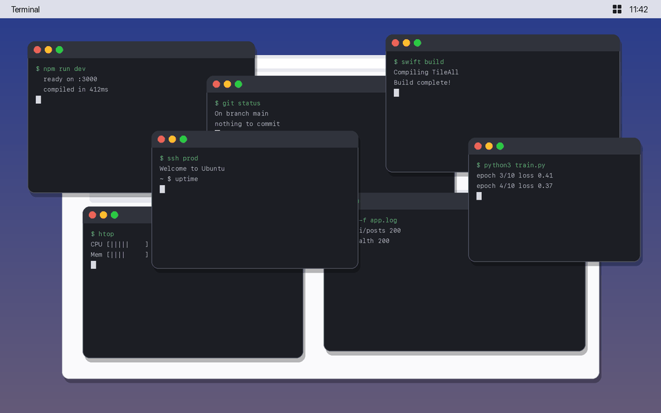

<p align="center"></p>

<h1 align="center">Tile All</h1>

<p align="center">
  <b>One shortcut puts every window of the app you're using into an even grid that fills the screen.</b><br>
  macOS can tile two to four windows. Tile All works with six, eight, twelve or however many you have open.
</p>

<p align="center">
  <a href="https://github.com/cadenburleson/tile-all/releases/latest/download/TileAll.dmg"><b>⬇ Download Tile All for Mac</b></a><br>
  <sub>macOS 13 or later · free and open source · signed and notarized by Apple</sub>
</p>

## Install

1. Download **TileAll.dmg** from the link above and open it.
2. Drag **Tile All** into **Applications**, then open it. A grid icon appears in the menu bar.
3. macOS asks for permission to control windows. Click **Open System Settings** and turn on **TileAll** under **Privacy & Security → Accessibility**. If it isn't listed, click **+** and choose it from Applications.

## Use

| Shortcut | What it does |
| --- | --- |
| **⌃⌥⌘G** (Control, Option, Command, G) | Tile the windows of the app you're in |
| **⌃⌥⌘⇧G** (add Shift) | Tile every app's windows |
| **⌃⌥⌘Z** | Put the windows back where they were |

The menu bar icon also has these actions, plus **Gaps Between Windows** and **Launch at Login**.

### How the grid is chosen

Tile All picks the number of rows that keeps each window closest to square, and every row is stretched to the full width of the screen, so nothing is left empty:

| Windows | Layout |
| --- | --- |
| 2 | side by side |
| 4 | 2 × 2 |
| 5 | 3 on top, 2 below |
| 6 | 3 × 2 |
| 7 | 4 on top, 3 below |
| 8 | 4 × 2 |
| 12 | 4 × 3 |

Windows keep their rough position (the top ones stay in the top row) and each display is tiled on its own. Minimized, hidden and full-screen windows are left alone, and so are windows on other desktops. Some apps won't shrink below a minimum size, so their windows can overlap a little in a dense grid.

## Build from source

```sh
git clone https://github.com/cadenburleson/tile-all.git
cd tile-all
scripts/install.sh   # builds, signs, copies to /Applications and launches
```

You need the Xcode command line tools. `TileAll --layout 8 1728x1080` prints the grid for 8 windows without moving anything. `python3 scripts/make-demo-gif.py` redraws the demo GIF (needs Pillow).

## License

[MIT](LICENSE)
